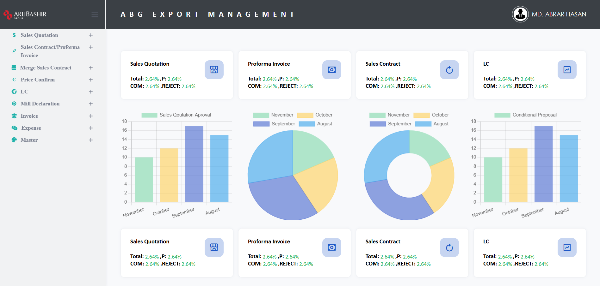
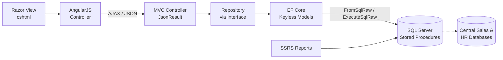

# Export Management - Jute & Textile Export Operations

An enterprise ERP that manages the complete export cycle for jute and textile mills, from sales quotation and sales contract to price confirmation, LC, mill declaration, invoicing and shipping documents, with a configurable multi-level approval workflow and SSRS document generation.




<p align="center"><em>Management dashboard: document status overview for sales quotations, proforma invoices, sales contracts and LCs, with monthly approval trends (sample data shown)</em></p>

---

## Overview

Export operations at jute and textile mills involve many dependent documents, each needing review and approval before the next step can begin. ABG Export Management replaces spreadsheet- and paper-based tracking with a single system that:

- Takes an order from **sales quotation → proforma invoice / sales contract → price confirmation → LC → mill declaration → invoice**
- Routes every key document through a **configurable approval matrix**
- Integrates with the group's **central sales, item and HR databases** so master data is never duplicated
- Generates **shipping and commercial documents** automatically through SSRS

The system is in production use across multiple seller units (jute mills) of the group.

> **Role:** Sole developer: requirement analysis, database design, back end, front end, reporting and ongoing maintenance.

---

## Key Features

### Sales & Contract Management

- **Sales Quotation:** item-type-aware form (Yarn, Weaving, Non-Woven) where available fields change by product type; searchable item lookups; one-click quotation copy with automatic numbering
- **Proforma Invoice & Sales Contract:** creation, editing and conversion of a proforma invoice into a sales contract
- **Merge Sales Contract:** combine multiple contracts, including partial lines and partial quantities, with header-level validation and proportional discount handling
- **Price Confirmation:** price approval per contract with automatic revision history on final approval
- **LC Management:** letter of credit tracking against contracts

### Production, Packing & Invoicing

- **Mill Declaration (Packing Request):** packing details by truss, bale, bundle, pallet and carton, with automatic structured invoice number generation
- **Invoice (Picking & Packing):** invoice preparation from approved packing requests
- **Expense / Freight Cost:** freight cost entry with approval and integration with the group's central ERP to raise service purchase orders

### Approval Workflow

- Configurable, multi-level **approval matrix** used across modules
- **Multi-approver (OR) approval:** any one of several approvers at a level can approve; the rest are closed automatically
- Approver routing resolved per seller unit
- Document status tracking (pending, approved, rejected, completed) shown on the dashboard

### Reporting & Documents (SSRS)

| Document                          | Purpose                                                             |
| --------------------------------- | ------------------------------------------------------------------- |
| Sales Contract                    | Formatted contract with grouped item specifications and price terms |
| Packing List / Short Packing List | Package-wise shipment details                                       |
| Packing Invoice                   | Commercial invoice for shipment                                     |
| Delivery Challan                  | Delivery document with continuous package ranges                    |

---

## Tech Stack

| Layer         | Technologies                                                                            |
| ------------- | --------------------------------------------------------------------------------------- |
| **Front End** | AngularJS (1.x), jQuery, AJAX, Razor Views (cshtml), JavaScript, HTML5, CSS3            |
| **Back End**  | C#, ASP.NET Core 7 MVC, Entity Framework Core                                           |
| **Database**  | Microsoft SQL Server (multi-database), T-SQL stored procedures, table-valued parameters |
| **Reporting** | SQL Server Reporting Services (SSRS)                                                    |
| **Tools**     | Visual Studio, SSMS, Report Builder, Git                                                |

---

## Architecture

Every module follows the same six-layer pattern, which keeps the codebase consistent and makes new modules quick to build.



**Design decisions:**

- **Stored-procedure-centric data access:** approval routing, document numbering and merge logic run inside the database for transactional integrity.
- **Table-valued parameters:** multi-line documents are saved in a single round trip.
- **Interface-based repositories with dependency injection:** controllers depend on abstractions, not data access code.
- **Cross-database integration:** customers, items and employees are read from the group's central databases rather than copied.

---

## Project Structure

```
export-management-erp/
├── ImportExport.sln
├── ExportDB/              # Database project
└── ImportExport.UI/       # ASP.NET Core MVC application
    ├── Controllers/
    ├── Views/             # Razor views (cshtml)
    └── wwwroot/           # AngularJS controllers, scripts, styles
```

---

## Getting Started

> **Note:** Production databases, stored procedures and data are not included in this repository. Configuration values below are placeholders.

### Prerequisites

- [.NET 7 SDK](https://dotnet.microsoft.com/download)
- Microsoft SQL Server
- SQL Server Reporting Services (optional, for reports)

### 1. Clone the repository

```bash
git clone https://github.com/mdabrarhasan/Export-Management.git
cd export-management-erp
```

### 2. Configure the connection strings

Update `ImportExport.UI/appsettings.json` with your own values for each database:

```json
"ConnectionStrings": {
  "DefaultConnection": "Server=YOUR_SERVER;Database=YOUR_EXPORT_DB;User Id=YOUR_USER;Password=YOUR_PASSWORD;TrustServerCertificate=True"
}
```

### 3. Run the application

```bash
dotnet restore
dotnet run --project ImportExport.UI
```

Open the URL shown in the terminal in your browser.

---

## About This Project

ABG Export Management was developed for the export operations of **AkijBashir Group**, which is published here with the company's permission for portfolio purposes. All credentials, server addresses and production data have been removed.

## Author

**Md Abrar Hasan**: Full-Stack Developer (ASP.NET Core · Angular · SQL Server)

- GitHub: [https://github.com/mdabrarhasan](https://github.com/mdabrarhasan)
- LinkedIn: [https://linkedin.com/in/mdabrarhasan](https://www.linkedin.com/)
- Email: abrarhasan2616@gmail.com

## License

This source code is proprietary and shared for portfolio review only. All rights reserved.
